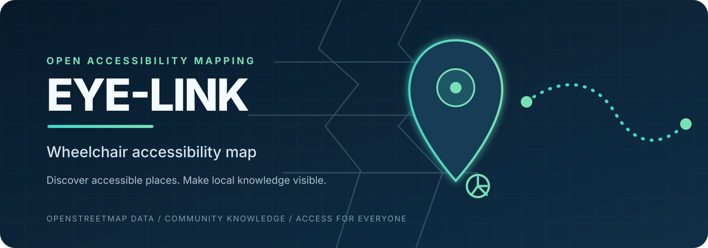
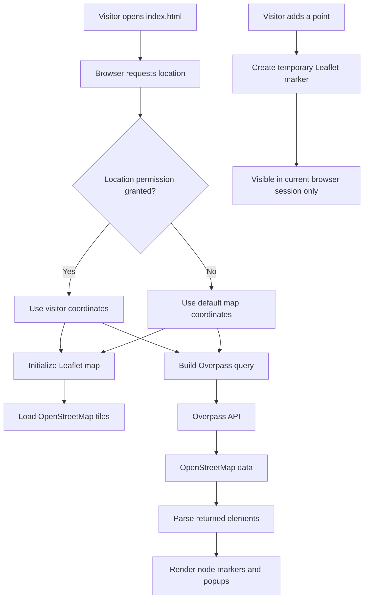
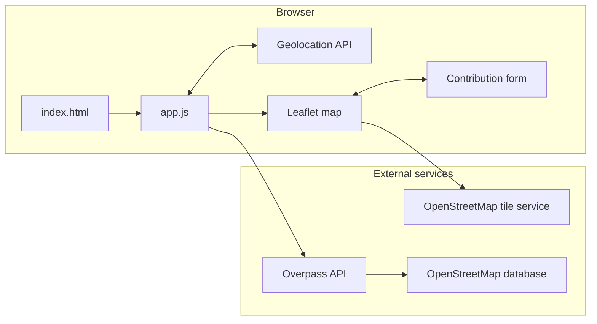

<div align="center">



# EYE-LINK

### A community-informed map for discovering wheelchair-accessible places.

[](https://www.openstreetmap.org/)
[](https://leafletjs.com/)
[](https://developer.mozilla.org/en-US/docs/Web/JavaScript)
[](https://nextjs.org/)
[](#project-status)

[Overview](#overview) · [Features](#features) · [Architecture](#architecture) · [Run locally](#run-locally) · [Limitations](#known-limitations) · [Roadmap](#roadmap) · [Contributing](#contributing)

</div>

---

## Overview

EYE-LINK is a wheelchair-accessibility mapping prototype. It uses browser geolocation, Leaflet, OpenStreetMap map tiles, and the Overpass API to help people explore places that have wheelchair-accessibility tags in OpenStreetMap.

The project is built around a simple idea: accessibility information is more useful when it is visible, location-aware, and improved by local knowledge. EYE-LINK provides a map interface for exploring tagged places and trying out community-submitted map markers.

> **Important:** EYE-LINK is an early-stage prototype, not a verified accessibility service. OpenStreetMap coverage varies by location, and a map tag cannot guarantee that a venue is suitable for a particular person's needs. Confirm critical details with the venue before travelling.

## At a glance

| Area | Current implementation |
|---|---|
| Map rendering | Leaflet with OpenStreetMap tiles |
| Location | Browser Geolocation API, with a default map fallback |
| Accessibility data | Overpass API query for selected wheelchair tags |
| Markers | Leaflet markers and popups for returned node elements |
| User-added locations | Temporary markers held in the current browser session |
| Persistence | Not implemented for user-added locations |
| Authentication | Not implemented in the standalone prototype |
| Application entry point | Root `index.html` and `app.js` |

## Features

- **Location-aware map:** requests browser location and centres the map when permission is granted.
- **Open map data:** retrieves nearby OpenStreetMap elements through the Overpass API.
- **Accessible-place markers:** displays returned point features with a popup containing available tag information.
- **Contribution prototype:** lets a visitor place a temporary marker and add a name, category, accessibility level, and notes.
- **Responsive map panel:** includes a compact information panel for smaller screens.
- **Open ecosystem:** built with Leaflet and OpenStreetMap data rather than a proprietary map renderer.

## Architecture

The diagrams below are Mermaid diagrams. GitHub renders them directly in the README, so they remain readable and update alongside the source documentation.

### Data flow



### Runtime components



### Repository layout

```text
EYE-LINK-PROJECT/
├── assets/
│   └── eye-link-banner.svg
├── index.html              # Standalone browser entry point
├── app.js                  # Leaflet map and Overpass integration
├── README.md               # Project documentation and live diagrams
├── package.json            # JavaScript / Next.js package configuration
├── package-lock.json       # npm dependency lockfile
├── pnpm-lock.yaml          # pnpm dependency lockfile
├── middleware.ts           # Current Next.js pass-through middleware
├── next.config.ts          # Next.js configuration
├── tailwind.config.ts      # Tailwind configuration
├── postcss.config.mjs      # PostCSS configuration
├── tsconfig.json           # TypeScript configuration
└── components.json         # UI component generator configuration
```

## Run locally

The currently runnable map prototype is the root-level static site. It does not require the Next.js development server.

### Requirements

- Node.js (for the optional static server)
- A modern browser
- Internet access for map tiles and Overpass requests
- Location permission for automatic centring (optional)

### Start the prototype

1. Clone the repository:

   ```bash
   git clone https://github.com/RITESH2127/EYE-LINK-PROJECT.git
   cd EYE-LINK-PROJECT
   ```

2. Start a local static server from the repository root. For example, with Python:

   ```bash
   python -m http.server 8000
   ```

   Or, if Node.js is installed:

   ```bash
   npx http-server . -p 8000
   ```

3. Open [http://localhost:8000](http://localhost:8000).

4. Allow location access if you want the map to centre on your current position. If permission is denied, the prototype uses its default coordinates.

A local server is recommended instead of opening the HTML file directly. Browser geolocation is generally available only in secure contexts such as localhost and HTTPS.

## How it works

1. The browser loads Leaflet and the page's map interface.
2. EYE-LINK requests the visitor's coordinates using the Geolocation API.
3. The app builds an Overpass QL query for nearby elements tagged `wheelchair=yes` or `wheelchair=designated`.
4. The Overpass API returns matching OpenStreetMap elements.
5. The current implementation creates map markers for returned **nodes** with coordinates and displays available name, amenity, entrance, description, and element ID values.
6. The visitor can enter add-point mode, click the map, and create a temporary marker with additional details.

## Data sources and attribution

- **OpenStreetMap:** map data and community-maintained accessibility tags. [Copyright and attribution](https://www.openstreetmap.org/copyright).
- **Overpass API:** read-only query interface for OpenStreetMap data. [API documentation](https://wiki.openstreetmap.org/wiki/Overpass_API).
- **Leaflet:** open-source interactive mapping library. [Documentation](https://leafletjs.com/).

Please respect the usage policies and capacity limits of the public Overpass and tile services. For a production deployment, consider an appropriate service provider, caching strategy, request throttling, and clear attribution.

## Known limitations

These limitations reflect the current source code and should be addressed before treating EYE-LINK as a production accessibility tool.

| Area | Current limitation | Suggested next step |
|---|---|---|
| Data coverage | Results depend on the completeness and accuracy of OpenStreetMap tags. | Show data provenance and allow users to report outdated information. |
| Element handling | The query requests nodes, ways, and relations, but marker creation currently handles nodes only. | Resolve geometry for ways and relations before rendering them. |
| Accessibility tags | The query selects `yes` and `designated`; the current `limited` display branch is not reached by that query. | Include and distinguish `limited`, `no`, and `unknown` states where appropriate. |
| Contributions | User-added markers are only held in the current page session. | Add a validated backend, moderation, and persistent storage. |
| Input safety | Popup HTML is assembled from map tags and form input. | Escape untrusted text or build popup content using safe DOM APIs. |
| Error handling | Network and API failures have only basic user feedback. | Handle HTTP status codes, rate limits, malformed responses, and retry states. |
| Routing | The current prototype does not calculate step-free routes. | Integrate routing only when reliable accessibility constraints and data are available. |
| Next.js scaffold | Next.js configuration exists, but no tracked `app/`, `src/app/`, or `pages/` route entry point is present. | Decide whether to complete the Next.js app or keep the static prototype as the primary application. |

## Roadmap

The roadmap prioritizes correctness, trust, and user safety before adding complex features.

### Phase 1 — Reliable map foundation

- [x] Browser geolocation with fallback coordinates
- [x] Leaflet map and OpenStreetMap tiles
- [x] Overpass API integration
- [x] Basic accessibility markers and popups
- [x] Temporary map contribution flow
- [ ] Render node, way, and relation geometries correctly
- [ ] Add robust loading, empty, and error states
- [ ] Escape all untrusted popup and form content

### Phase 2 — Trusted accessibility information

- [ ] Clearly distinguish accessible, limited, inaccessible, and unknown information
- [ ] Show which OpenStreetMap tags support each marker
- [ ] Add freshness and data-source context
- [ ] Add filters by facility type and accessibility attributes
- [ ] Provide a clear report/correction workflow

### Phase 3 — Persistent community contributions

- [ ] Design a database schema and backend API
- [ ] Add authentication and authorization where needed
- [ ] Validate and moderate submissions
- [ ] Store contributor reports separately from verified OpenStreetMap data
- [ ] Add audit history and abuse prevention

### Phase 4 — Accessible journey planning

- [ ] Investigate routing engines that support wheelchair constraints
- [ ] Represent barriers, surface quality, kerbs, slopes, and step-free access
- [ ] Communicate missing route data and uncertainty
- [ ] Test journeys with wheelchair users and accessibility specialists

## Development notes

This repository currently contains a standalone Leaflet prototype alongside Next.js, TypeScript, and Tailwind configuration files. The root `index.html` and `app.js` are the entry point for the working prototype described above.

The repository also contains both `package-lock.json` and `pnpm-lock.yaml`. Choose one package manager for ongoing development and keep its lockfile authoritative. The Next.js scripts should not be considered verified until a Next.js route entry point is added and a clean install/build is tested.

## Contributing

Contributions that improve accuracy, usability, accessibility, and safety are especially welcome.

1. Open an issue describing the problem or proposed change.
2. Fork the repository and create a focused feature branch.
3. Make the smallest coherent change.
4. Test the map in a browser, including location-denied and API-error scenarios where relevant.
5. Include screenshots or a short screen recording for interface changes.
6. Open a pull request with a clear summary, test notes, and any known limitations.

For accessibility-related changes, explain which user need the change addresses and how it was tested. Do not label a location as fully accessible unless the available evidence supports that claim.

## License

No license file is currently present in this repository. Until a license is added, reuse, redistribution, and contribution terms are not explicitly granted. Add a license file before describing this project as MIT-licensed.

## Maintainer

Created and maintained by [Ritesh Kumar](https://github.com/RITESH2127).

- Repository: [RITESH2127/EYE-LINK-PROJECT](https://github.com/RITESH2127/EYE-LINK-PROJECT)
- Issues: [Report a bug or request a feature](https://github.com/RITESH2127/EYE-LINK-PROJECT/issues)

---

<div align="center">

**EYE-LINK — making accessibility information easier to discover.**

</div>
